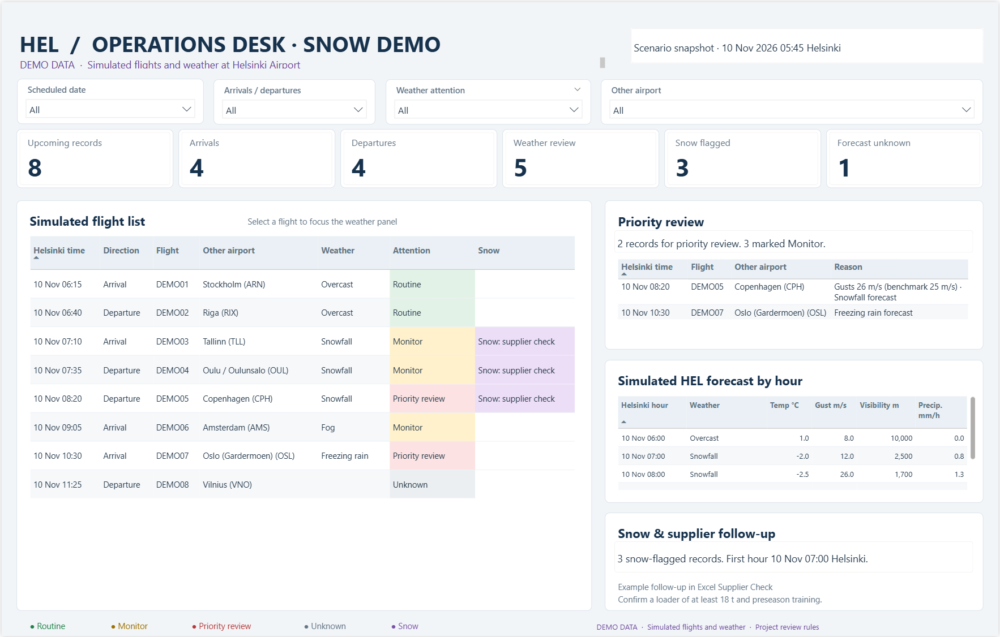
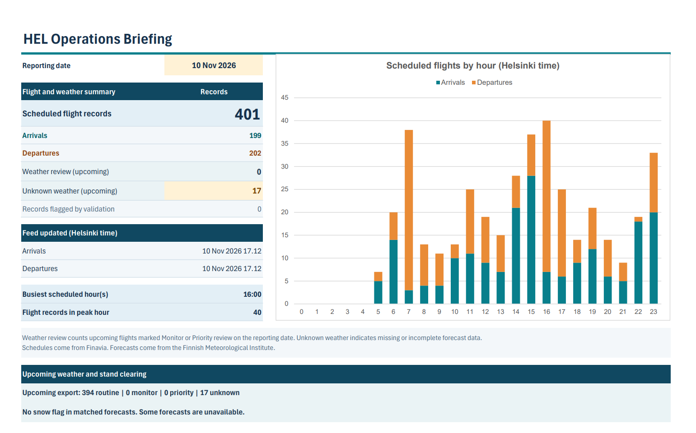

# HEL Operations Intelligence

I built this independent portfolio project to turn Helsinki Airport flight schedules and hourly weather forecasts into an operations briefing. The Power BI dashboard shows when scheduled traffic peaks and which upcoming flights need weather review. The Excel briefing adds a supplier readiness check and an automated PDF archive.



*Simulated winter conditions in Power BI. The purple snow flag identifies a window for supplier follow-up.*

## Procurement use case

A snowfall forecast gives ground operations and procurement a specific window for checking whether the snow-clearing supplier is ready. I translated that question into an Excel check with explicit criteria and a record of the confirmation. The use case was inspired by Finavia’s historical apron snow-clearing procurement, Lot C. [Historical procurement notice](https://fi.openprocurements.com/tender/2019-finavia-oyj-n-helsinki-vantaa-lentoaseman-turvatarkastetun-alueen-talvikunnossapidon-lumen-aura/)

1. **Identify the window.** SQL flags upcoming flights that match a snowfall forecast. Excel finds the first flagged hour and shows how many arrivals and departures are scheduled in that window.
2. **Record the supplier’s confirmation.** The reviewer enters the available loader weight and whether preseason training was confirmed. The input is keyed to the forecast window, so a different hour requires a fresh confirmation.
3. **Check readiness and record the outcome.** Excel compares the entered weight with the project’s **18-tonne benchmark** and checks training separately. The briefing distinguishes an outstanding confirmation from a plan that meets both checks or needs follow-up. The result goes into the archived briefing and run log.

For example, in a simulated snow window, a **16-tonne loader** with training unconfirmed triggers follow-up on both equipment and training. This gives the reviewer two specific questions to resolve with the supplier.

## How I used the tools

| Skill | How I applied it |
| --- | --- |
| **Python and APIs** | Captured Finavia flight XML and FMI hourly forecasts, validated incoming records, loaded snapshots into PostgreSQL, and exported the reporting data. [Python scripts](scripts/) |
| **SQL and data modelling** | Modelled snapshots and flight observations in PostgreSQL, built views for the latest arrivals and departures, and joined flight schedules to forecasts by UTC hour. Helsinki local time is used for reporting. [Schema](sql/001_snapshot_tables.sql) · [Weather views](sql/008_fmi_weather.sql) |
| **Analytics and data science concepts** | Aggregated flights by hour and direction to find traffic peaks. Used gusts, rainfall, and forecast symbols in rule-based weather classifications, with an Unknown category for insufficient forecast data. Checked the logic against simulated winter cases. [Weather rules](sql/008_fmi_weather.sql) |
| **Power BI** | Used Power Query to load weather-enriched flight records and DAX measures to show flight totals, priority cases, and the first snow hour. Date, direction, weather level, and airport filters let reviewers inspect the underlying records. [Power Query source](powerbi/Flights_With_Weather.pq) |
| **Excel and reporting controls** | Used Power Query to import the CSVs, then built a one-page briefing that reconciles Excel counts against SQL control totals. Formulas including `MINIFS`, `XLOOKUP`, and `COUNTIFS` identify the first snow window and its flight counts. [Export and SQL controls](scripts/export_excel.py) |
| **Power Automate Desktop** | Automated the Excel refresh, checked the export manifest and reconciliation result, and saved a dated workbook, PDF, and run log when the checks passed. [PowerShell actions](automation/) |
| **AI tools** | Used ChatGPT during development to review implementation options, design test cases, and troubleshoot Power Query, Excel, and Power Automate. Checked the resulting logic against SQL control totals and simulated cases. |
| **Testing and communication** | Tested data parsing, snapshot loading, and export verification. Presented the results as a briefing that shows the forecast window, the records affected, and what someone needs to confirm. [Tests](tests/) |



*Example briefing archived as a PDF by Power Automate Desktop after the reconciliation checks passed.*
In the saved briefing for **10 November 2026**, Helsinki had **401 scheduled flight records**. The busiest hour was **16:00 Helsinki time**, with **40 scheduled records**.

## Run the data pipeline

From the repository root in Windows PowerShell, set up the Python environment and create local configuration.

```powershell
py -3 -m venv .venv
.\.venv\Scripts\python.exe -m pip install -r requirements-db.txt
if (-not (Test-Path .env)) { Copy-Item .env.example .env }
```

Set `FINAVIA_API_KEY` in `.env` and use the `HEL` airport with the `all` flight type. Create a local PostgreSQL database named `hel_operations`. The scripts default to `127.0.0.1:5432` with user `postgres` and prompt for the database password if needed.

```powershell
.\.venv\Scripts\python.exe scripts\fetch_finavia.py
.\.venv\Scripts\python.exe scripts\load_postgres.py --init-db
.\.venv\Scripts\python.exe scripts\fetch_fmi_weather.py --export
.\.venv\Scripts\python.exe scripts\export_excel.py --verify-only
```

The verified CSVs and manifest are written to `data/processed/excel/`. The repository includes the Power Query source and the Power Automate script actions. The desktop reporting workflow uses a locally configured Power BI report, Excel workbook, and Power Automate Desktop flow.

## Tests

```powershell
.\.venv\Scripts\python.exe -m unittest discover -s tests -v
```

The collector and parser tests use mock HTTP responses and synthetic XML. PostgreSQL integration tests run when `HEL_TEST_DSN` points to an empty test database.

## Data sources

Flight schedules come from the Finavia Public Flights API and forecasts come from FMI's HARMONIE model for Helsinki Airport. [Finavia API portal](https://apiportal.finavia.fi/) · [FMI Open Data](https://en.ilmatieteenlaitos.fi/open-data)
